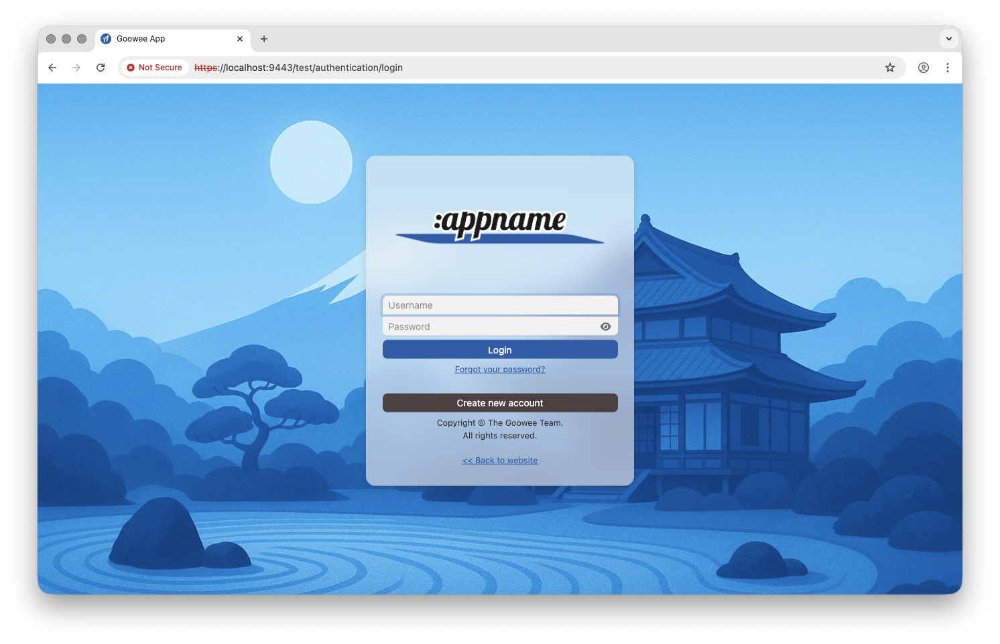

[](https://x.com/gooweeframework)

# Goowee Application Template

With [Goowee](https://goowee.org), you can build enterprise applications with AI and [Apache Groovy](https://groovy-lang.org).

## Getting started
Make sure you have [Git](https://git-scm.com) and a [JDK](https://www.oracle.com/java/technologies/downloads/) installed. Java 21 or later is required.
```
$ git clone https://github.com/goowee-projects/goowee-app-template
$ cd goowee-app-template
$ ./gradlew bootRun
```

> The first run may take a few minutes while Gradle downloads the required dependencies.

You should see something like this:

```
>                                                                            <
>                     _ __ ___  _   _  __ _ _ __  _ __                       <
>                    | '_ ` _ \| | | |/ _` | '_ \| '_ \                      <
>                    | | | | | | |_| | (_| | |_) | |_) |                     <
>                    |_| |_| |_|\__, |\__,_| .__/| .__/                      <
>                               |___/      |_|   |_|                         <
>                                                                            <
>                Change me in /src/main/resources/banner.txt                 <
>                                                                            <

Grails application running at http://localhost:8080 in environment: development
```

Open [http://localhost:8080](http://localhost:8080) in your browser, then:
- Log in as `super`/`super` to manage the entire application.
- Log in as `admin`/`admin` to manage the `DEFAULT` tenant.



## New application
You can use this template to create a new application with an AI agent or manually.

### AI agent
Ask an AI agent to run these prompts:

1. `Rename the application and the corresponding packages to "myapp".`
2. `Create a Goowee app to manage a “person” with the following columns: firstname, lastname, age, gender.`

### Manually
1. Find and replace `gooweeapp` with your chosen application name in all project files.
2. Rename the `gooweeapp` package to match your application name.
3. See the `template` package for an implementation example.

## Build the executable JAR
1. Run `./gradlew bootJar`
2. The application JAR will be generated in `build/libs`.
3. Run the application with `java -jar gooweeapp-1.0-SNAPSHOT.jar`.

## Project documentation
The documentation source files are in `src/docs`.
1. Write the content in [AsciiDoc](https://asciidoctor.org/docs/asciidoc-syntax-quick-reference/).
2. Generate the documentation by running `./gradlew asciidoctor`.
3. The generated HTML files will be available in the `docs` directory.

To edit this README, write the content in [Markdown](https://www.markdownguide.org/cheat-sheet/).

## Learn more
- Documentation: https://goowee.org/docs

## License
Goowee is open-source software released under the [Apache License, Version 2.0](https://www.apache.org/licenses/LICENSE-2.0.html).
